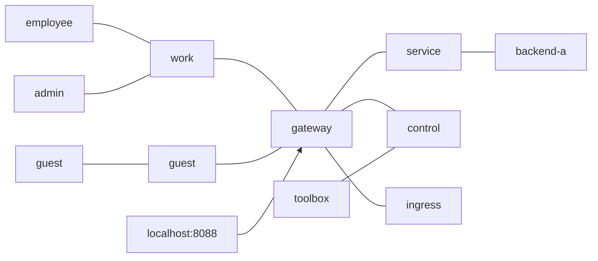

# Запуск ПР4

Використовуйте той самий репозиторій та підготовлені в ПР3 образи
([підготовка базових образів](pr03-reproduction.md)). Для HAProxy також
завантажте точний digest із незміненого `tests/images.lock.json`, оскільки
номерний тег Docker Hub може вказувати на оновлений образ:

```sh
docker pull haproxy@sha256:2caaf8b1a1ef67f3f1ea9b721f2821675d3ba4500fb518e23884fecb93e8dbaa
docker tag haproxy@sha256:2caaf8b1a1ef67f3f1ea9b721f2821675d3ba4500fb518e23884fecb93e8dbaa haproxy:3.4.7-alpine
sh tests/compose.sh pr04 up -d --build
sh tests/check.sh pr04
```

`work`, `guest`, `service` і `control` залишаються внутрішніми. Лише gateway
додатково підключений до `ingress`: Docker не створює прив'язування host-порту
для контейнера, що має тільки внутрішні мережі. Порт gateway прив'язаний
виключно до `127.0.0.1`; employee, guest, admin та backend до ingress не входять.
Див. [обговорення Docker](https://github.com/moby/moby/discussions/53256).



Очікування: employee → gateway:8080 та guest → gateway:8080 повертають
`backend-a`; employee → admin:8000 повертає `admin`; guest → усі IP admin,
TCP 8000, має бути заблокований. Перевірка лише work-IP могла б пропустити
доступний guest-інтерфейс; тому LEAK_CONTROL перевіряє всі фактичні адреси,
виявляє доданий інтерфейс та перевіряє ізоляцію після його відключення.

Для досліду з портом змініть лише `PUBLIC_PORT` у локальному `.env`,
застосуйте `sh tests/compose.sh pr04 up -d gateway` та відкрийте
`http://127.0.0.1:НОВИЙ_ПОРТ/identity`. Внутрішній порт 8080 не змінюється.
Після повернення `PUBLIC_PORT=8088` повторіть `up -d` і повний `check.sh`.
Автоматичний протокол створює тест у `docs/reports/pr04.md`.
