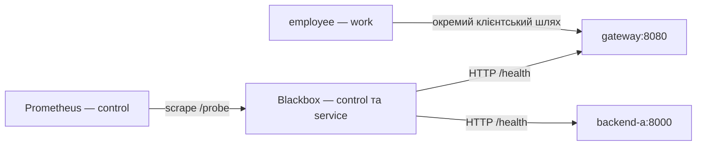

# Запуск ПР5

Продовжуйте той самий проєкт після ПР4. Використовуйте базові образи з
[ПР3](pr03-reproduction.md) і HAProxy з [ПР4](pr04-reproduction.md).
Prometheus і Blackbox завантажуються за digest із незміненого
`tests/images.lock.json`:

```sh
docker pull prom/prometheus@sha256:aafa9d694e6a883c02db516d9f6e5b84e14195f49a2a6456a4cca815edda72b9
docker tag prom/prometheus@sha256:aafa9d694e6a883c02db516d9f6e5b84e14195f49a2a6456a4cca815edda72b9 prom/prometheus:v3.13.5
docker pull prom/blackbox-exporter@sha256:ea1c7aa3ef3f307cd03e85f34abb604478ccb90b567fc690da0cd9776da76b13
docker tag prom/blackbox-exporter@sha256:ea1c7aa3ef3f307cd03e85f34abb604478ccb90b567fc690da0cd9776da76b13 prom/blackbox-exporter:v0.29.1
sh tests/compose.sh pr05 --profile monitoring up -d
sh tests/check.sh pr05 --quick
sh tests/check.sh pr05
```

Prometheus доступний тільки на `http://127.0.0.1:9090/targets`.
Мережа ingress потрібна для опублікування localhost-порту в Docker;
control залишається внутрішньою. Blackbox має лише control і service,
його порт на хості не публікується.



Проба gateway перевіряє HTTP-шлях через HAProxy до backend, а проба
backend-a — доступ до сервера напряму з Blackbox. Вони не замінюють
перевірку доступу employee з мережі work.

Для порівняння станів використовуйте свіжі значення `probe_success` і
`up{job="blackbox"}` з потрібною міткою instance:

| Стан цілі backend-a | probe_success | up | Контрольне спостереження |
|---|---:|---:|---|
| Штатний порт 8000 | 1 | 1 | Gateway повертає backend-a |
| Хибна target з портом 8999 | 0 | 1 | Backend працює; gateway далі повертає backend-a |
| Повернуто target з портом 8000 | 1 | 1 | Штатна проба знову успішна |

Стара серія для порту 8000 може ще бути присутня під час хибної target.
Тому звіряйте instance і час останнього зразка. При `up=0` спочатку
перевірте адресу `blackbox:9115`, доступ через control та журнали exporter.
HTTP-помилка сама по собі не доводить втрату пакетів.

Повний тест тимчасово змінює target і відновлює початкові байти
`config/prometheus.yml`, після чого чекає нові успішні зразки.
Звіт автоматично створюється в `docs/reports/pr05.md`; `.env` і `results/`
до Git не додаються. Після завершення зупиніть стенд:

```sh
sh tests/compose.sh pr05 --profile monitoring stop
```
