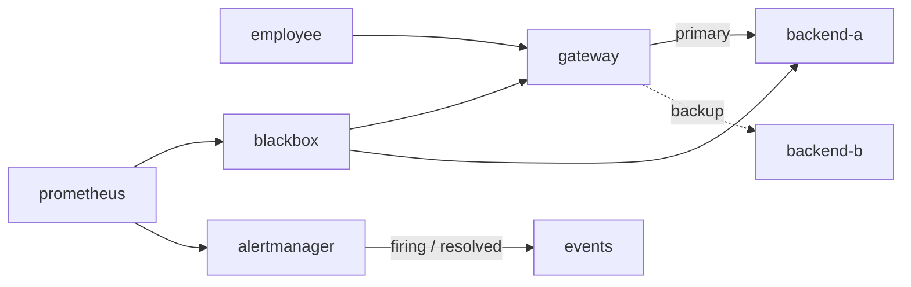

# Запуск ПР6

Продовжуйте той самий проєкт після [ПР5](pr05-reproduction.md).
Додатковий образ Alertmanager береться з незміненого lock-файла:

```sh
docker pull prom/alertmanager@sha256:39d8bb3966c694a124428a3a88fbcffd40bd069129ecd47c059f8a3f17c55f3b
docker tag prom/alertmanager@sha256:39d8bb3966c694a124428a3a88fbcffd40bd069129ecd47c059f8a3f17c55f3b prom/alertmanager:v0.34.2
sh tests/compose.sh pr06 --profile monitoring up -d --build
sh tests/compose.sh pr06 restart -t 1 gateway prometheus
sh tests/check.sh pr06 --quick
sh tests/check.sh pr06
```

Повний тест зупиняє лише backend-a, чекає перемикання HAProxy на
backend-b та нового webhook firing. Потім запускає primary, чекає
resolved і повернення відповіді backend-a. Старі події не підходять:
звіряються received_at, startsAt, alertname та instance цього досліду.
Повідомлення надходять лише до локального навчального `events:8001/alerts`.



Очікування для свіжих проб і клієнтського запиту:

| Стан | Проба primary | Проба gateway | Відповідь /identity | Подія |
|---|---:|---:|---|---|
| Норма | 1 | 1 | backend-a | — |
| Primary зупинено, резерв активний | 0 | 1 | backend-b | firing |
| Primary повернувся і пройшов health checks | 1 | 1 | backend-a | resolved |

Час доставки firing не дорівнює часу перемикання HAProxy: він залежить
також від scrape/evaluation, `for: 10s`, group_wait і доставки webhook.
Резерв backend не усуває відмову самого gateway: другого шлюзу немає.
Це HTTP-резервування, а не перебудова IP-маршрутів.

При примусовому перериванні досліду запустіть backend-a перед повтором:

```sh
sh tests/compose.sh pr06 start backend-a
```

Автоматичний звіт створюється у `docs/reports/pr06.md`. `.env`, журнал
`results/alerts.jsonl` та решта `results/` не додаються до Git.
Після завершення:

```sh
sh tests/compose.sh pr06 --profile monitoring stop
```
